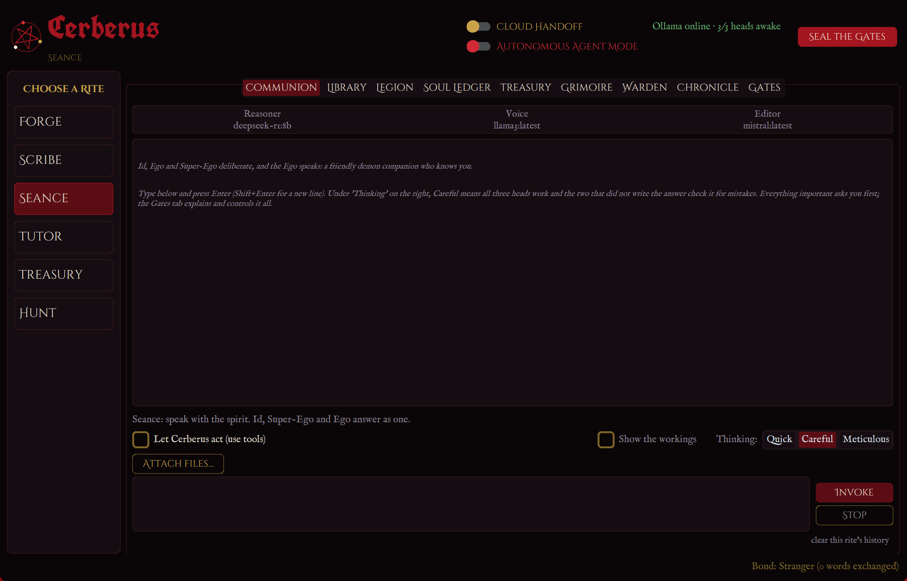
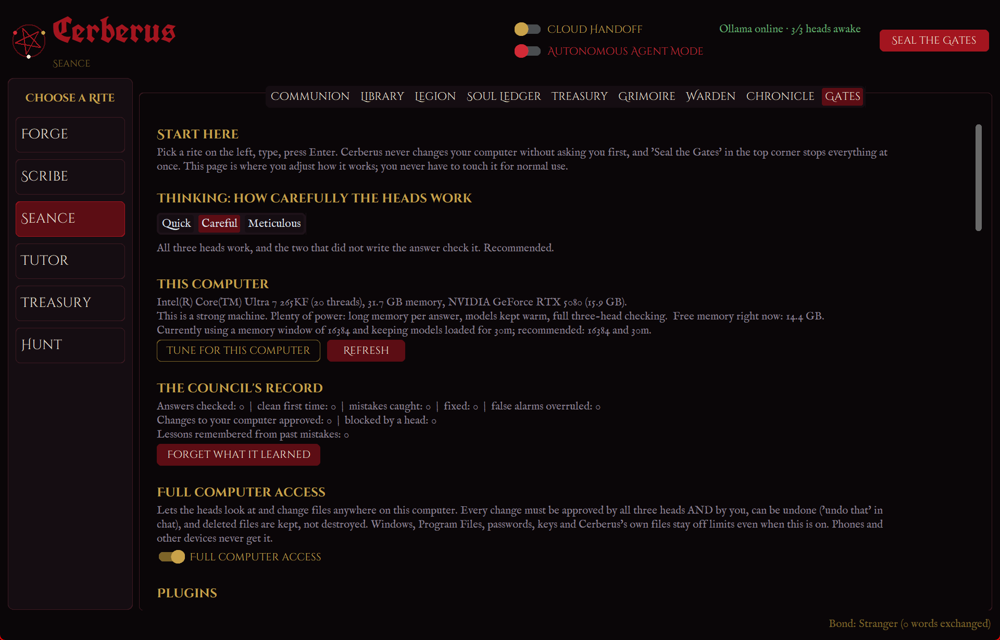
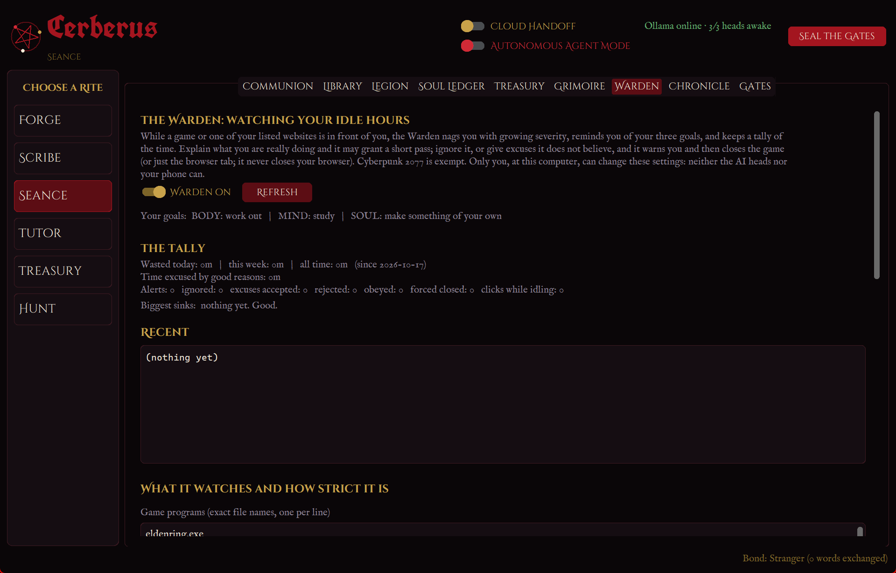
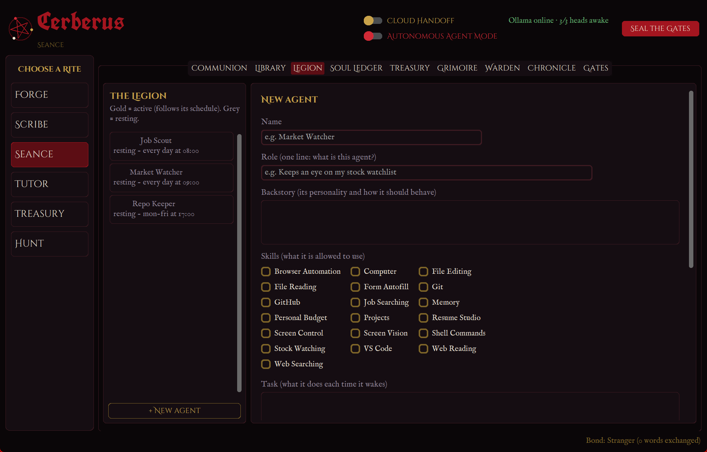
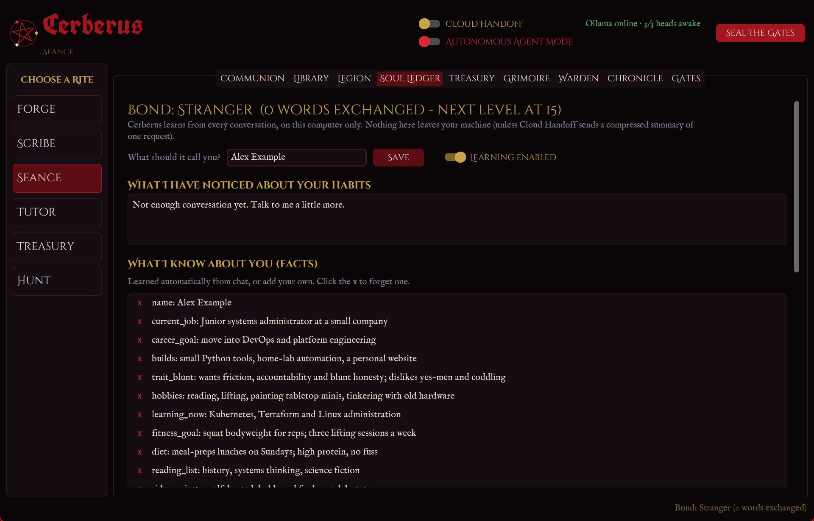

<div align="center">

# Cerberus

**A local, three-headed AI assistant for Windows. Three small models check each other's work, and nothing touches your PC without a unanimous vote *and* your approval.**

[](https://github.com/Hexxcraft/cerberus/actions/workflows/ci.yml)


[](LICENSE)



</div>

## What it is

Cerberus runs three [Ollama](https://ollama.com) models locally (DeepSeek-R1, Llama 3, Mistral) as a small council. One writes, the other two fact-check, and any claim that is disputed is ruled on by the head that did not raise it. It runs fully offline, can optionally hand a request to a big cloud model, learns about its user over time, and can look at and change files on the PC, but only when all three heads **and** you agree.

It is a single-user desktop app (CustomTkinter GUI) with a FastAPI backend and a phone web app (PWA) served over your LAN. It is built to be safe to leave running on a real machine, which is where most of the engineering went.

## Why it might interest you

This is a long-running solo project that is meant to be read as well as run. The parts I would point at:

- **Multi-model verification.** Writer, two reviewers, a per-claim ruling step that overrules false alarms, bounded repair rounds, and unresolved doubts surfaced to the user instead of hidden. Three selectable levels trade speed for accuracy.
- **A real safety model, tested.** Every tool has a risk level; anything that changes the PC needs a unanimous three-model vote plus user approval, with uncertainty counted as "no". Hard denylists (credentials, system folders, program folders, UNC and hidden-stream paths), an undo folder, a full audit log, SSRF-guarded web tools and a workspace guard are enforced in code, not in prompts.
- **Network trust boundary.** Loopback is "local"; everything else is "remote" and needs a bearer token. `local_only` endpoints and PC tools are unreachable from a phone even with the token, and the tests assert it.
- **Secrets handling.** API keys and tokens are sealed with Windows DPAPI, scrubbed from logs and API responses, and excluded from backups.
- **Test discipline.** 314 offline tests (a fake Ollama and an isolated data folder per test, no GPU or network needed), ruff lint, and CI on GitHub Actions. Behaviours that must never regress, such as "a phone cannot reach the file tools", are pinned down by tests.
- **Operational care.** Hardware guard (GPU/board temperature, memory and disk limits, resource-limited child processes), daily automatic backups with restore (secrets excluded), structured run log with a tuning report, and a plugin mechanism.
- **Privacy by design.** The operator profile is a file outside the repository; the repo ships only a fictional example.

Architecture write-up with a diagram: [docs/ARCHITECTURE.md](docs/ARCHITECTURE.md). Security policy: [SECURITY.md](SECURITY.md).

## Screenshots

<table>
  <tr>
    <td></td>
    <td></td>
  </tr>
  <tr>
    <td></td>
    <td></td>
  </tr>
</table>

(The screenshots use the fictional example profile in a clean data folder.)

## Features

| Rite | What it does |
|---|---|
| Forge | Builds software: Architect, Builder and Inspector produce a complete project; files are syntax-checked and auto-repaired. |
| Scribe | Editing, or ghost-writing in your voice (learned from samples you paste in). |
| Seance | Everyday conversation: three heads deliberate and one answers. |
| Tutor | Small steps, hands-on, calm tone, built for ADHD/autistic learners. |
| Treasury | Live quotes, watchlist, budget, plain-spoken analysis (not financial advice). |
| Hunt | Job search, resume and cover-letter tailoring, form-filling help (never submits for you). |

Also: background **agents** on plain-English schedules (`daily at 9am`), **Cloud Handoff** (OpenAI, Anthropic, Gemini, xAI, DeepSeek, Mistral, OpenRouter) with a token-budgeted prompt, the **Warden** idle-time watchdog, daily **rituals**, GitHub tools, a Library tab for attaching files as context, plugins, and a **phone page** you can install as an app. The full tour is in the [user guide](docs/USAGE.md).

## Quick start (Windows)

1. Install **Python 3.11+** and **[Ollama](https://ollama.com/download)**.
2. Pull the models: `ollama pull deepseek-r1:8b`, `ollama pull llama3`, `ollama pull mistral`. Optional: `nomic-embed-text` (recall by meaning) and `moondream` (read screenshots).
3. Double-click **`install.bat`** once, then **`run_cerberus.bat`**.

Prefer a standalone app with no Python? `scripts\build_exe.ps1` builds `dist\Cerberus\Cerberus.exe`, and a tagged release builds it in CI.

Phone: run `scripts\start_lan_server.bat`, open the printed address on the phone, enter the token once.

## How the safety model works

1. Every tool call is risk-rated (`safe`, `write`, `publish`, `control`).
2. Anything above `safe` goes through the **SafetyGate**: for PC changes, **Editor, Voice and Reasoner must all approve**, then **you** are asked. No answer in 3 minutes is "no".
3. **Always off limits**, before anyone is asked: credential stores and key files, browser profiles, `.env`, Windows and Program Files, Cerberus's own data, network paths, and executables outside the workspace.
4. Changes are **undoable**; deleted files go to an undo folder. Every call is written to an audit log.
5. Phones and other devices can chat and approve, but can never use PC tools, browse files, read logs or change settings.
6. *Autonomous Agent Mode* skips only the prompt to you, is never saved, and is off at every launch.

Details and the exact lists: [docs/USAGE.md](docs/USAGE.md#full-computer-access) and [SECURITY.md](SECURITY.md).

## Make it yours

Cerberus ships with a fictional example profile. Drop your own `profile.json` into `%LOCALAPPDATA%\Cerberus` to change what it calls you, how it talks, and your daily rhythm. See [docs/PROFILE.md](docs/PROFILE.md).

## Development

```powershell
python -m venv .venv
.\.venv\Scripts\python.exe -m pip install -r requirements.txt -r requirements-dev.txt
$env:PYTHONPATH = "."
.\.venv\Scripts\python.exe -m unittest discover -s tests -t .    # 314 tests, no Ollama needed
.\.venv\Scripts\python.exe -m ruff check .
.\.venv\Scripts\python.exe main.py --smoke                       # open every tab and save screenshots
```

Layout: `cerberus/` (orchestrator, council, safety, tools, server, warden, guard, agents, learning, cloud), `cerberus/gui/` (desktop app), `cerberus/web/` (phone PWA), `tests/`, `docs/`, `scripts/`, `plugins/`. See [CONTRIBUTING.md](CONTRIBUTING.md) for the rules that must keep holding.

## Honest limits

- Three small local models catch many mistakes, not all. They can agree on the same wrong answer, which is why surviving doubts are shown to you and why Cloud Handoff exists.
- Careful and Meticulous are deliberately slow; DeepSeek-R1 as a checker can take minutes.
- Windows only. CI runs on Windows; the GUI and the mouse/keyboard path are covered by smoke runs and mocked tests, not by automated UI tests.
- Resume Studio's form staging and the Warden's browser-tab closing are tested with mocks, not against live sites or browsers.
- The CPU temperature is only visible indirectly unless LibreHardwareMonitor is running.

More in the [user guide](docs/USAGE.md#known-limits).

## Roadmap

- Automated UI tests for the desktop app.
- Real-browser integration tests for tab closing and form staging.
- Signed release builds.

## License

[MIT](LICENSE). See the [changelog](CHANGELOG.md) for what changed and when.
