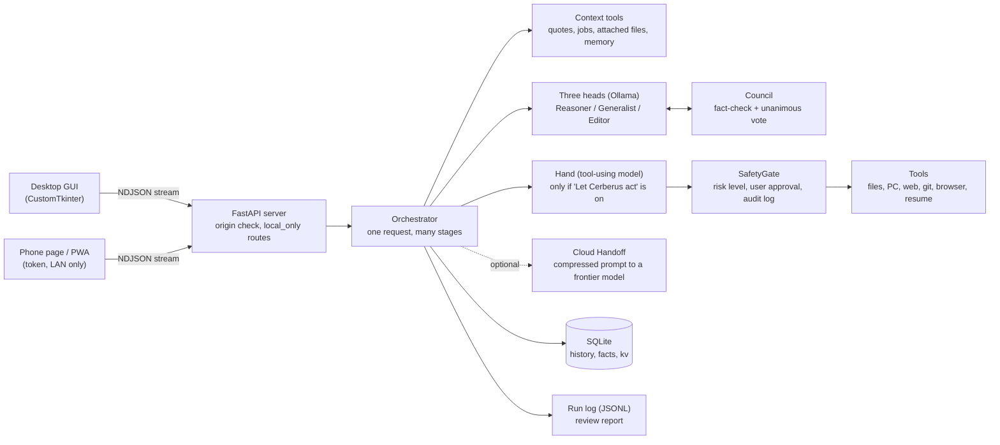

# Architecture

Cerberus is a single-user desktop application: a FastAPI backend and a CustomTkinter GUI in one process, talking to a local
[Ollama](https://ollama.com) server. The same HTTP API serves the phone/PWA page on the LAN.

## One request

1. The server authenticates the caller and records its origin (`local` or a remote device).
2. The orchestrator saves the message and gathers context with read-only tools (attached files are read here, local clients only).
3. If actions are on, a tool-using **Hand** carries them out. Every call goes through the **SafetyGate**; changes to the PC also need
   a unanimous council vote.
4. Each head of the chosen **rite** (mode) speaks in order, seeing the previous heads' work.
5. The **Council** fact-checks the answer. A problem counts only if it survives a second look by a head that did not raise it; the
   writer then revises, for a bounded number of rounds. Doubts that remain are shown to the user.
6. Optionally the local work is compressed into one prompt for a cloud model. If that fails, the local answer stands.
7. The answer, lessons learned and a telemetry line are written; the stream ends with a `final` event.

## Rites

| Name | Internal key | Purpose |
|---|---|---|
| Forge | `coding` | Builds software projects, syntax-checks and repairs them |
| Scribe | `writing` | Editing and ghost-writing in the user's own style |
| Seance | `conversation` | Everyday conversation |
| Tutor | `teaching` | Step-by-step learning support |
| Treasury | `wealth` | Quotes, watchlist, budget analysis |
| Hunt | `jobs` | Job search, resume tailoring, application staging |

The internal keys are stable identifiers stored in the database and API; only the display names are themed.

## Safety layers

| Layer | Where | What it enforces |
|---|---|---|
| Risk levels | `safety.py` | `safe` / `write` / `publish` / `control`. Anything above `safe` waits for the user (timeout = no). |
| Council vote | `council.py` | Three heads must each approve an exact PC change; an unclear reply counts as no. |
| Path rules | `tools/computer.py` | Hard denylists: system folders, secrets, Cerberus's own files, UNC/ADS paths. |
| Origin rules | `server.py` | Remote clients cannot use PC tools, browse files, read logs, or change settings (`local_only`). |
| Secret storage | `vault.py` | API keys sealed with Windows DPAPI, excluded from backups and logs. |
| Resource guard | `guard.py` | Temperature, memory and disk checks; every child process is limited. |
| Audit | `safety.py` | Every tool call is appended to `audit.log`. |

## Self-review loop

`telemetry.py` writes one JSON line per request (timings per step and tool, tool errors, council findings, outcome). `mistakes.py`
keeps a small, scrubbed, de-duplicated list of tool errors and feeds the useful ones back to the Hand. `python -m cerberus.telemetry`
turns the log into a report that ends with concrete things to tweak.

## Where things live

| Path | Contents |
|---|---|
| `cerberus/` | Backend: orchestrator, council, tools, safety, guard, Warden, telemetry |
| `cerberus/gui/` | Desktop app and its tabs |
| `cerberus/web/` | Phone page and PWA assets |
| `cerberus/seed/` | Example operator profile (a private profile can sit beside it, git-ignored) |
| `plugins/` | Plugin template; real plugins go in the user's data folder |
| `tests/` | Offline test suite (fake Ollama), plus opt-in end-to-end scripts |
| `%LOCALAPPDATA%\Cerberus` | User data: database, settings, logs, backups, undo folder |
